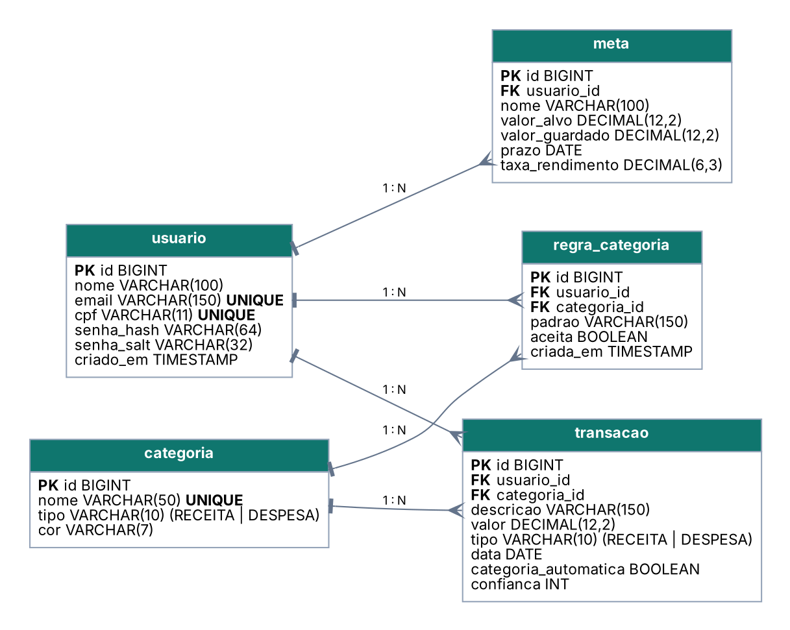

# FinIA – Controle de finanças pessoais com categorização automática

Projeto acadêmico (UCSAL, 2026) feito a partir da documentação de requisitos do FinIA.

**Autores:** Gabriel Oliveira Leônidas e Tiago Aragão · **Professor:** Elton Figueiredo da Silva
Back-end em **Java 17**, front-end em **HTML, CSS e JavaScript** e banco de dados **H2** integrado.

## O que o sistema faz

| Tela | O que dá para fazer | Back-end |
|---|---|---|
| **Login** | Entrar com e-mail e senha | ✅ |
| **Cadastro** | Criar conta (senha forte, e-mail único) | ✅ |
| **Início** | Ver receitas, despesas e saldo do mês, gráfico de gastos por categoria, últimas transações e metas | ✅ |
| **Transações** | Registrar receitas e despesas; a **IA escolhe a categoria** pela descrição; corrigir a categoria (o sistema aprende); excluir | ✅ |
| **Metas** | Criar metas com valor e prazo, ver quanto guardar por mês e ir guardando dinheiro | ✅ |

## Como executar

Precisa ter instalado: **Java 17 ou mais novo** e **Maven**.

```bash
mvn package                  # compila, roda os testes e gera target/finia.jar
java -jar target/finia.jar   # liga o sistema
```

Abra **http://localhost:8080** e entre com a conta de teste:

- e-mail: `demo@finia.com`
- senha: `Demo@1234`

Deixe o terminal aberto enquanto usa. Para desligar, aperte **Ctrl+C**.

Na primeira execução o banco `data/finia_simples.mv.db` é criado com dados de exemplo
(dois meses de transações e três metas). Para começar do zero, apague a pasta `data`.

## Como o código está organizado

```
Tela (HTML/JS)  ->  Controller  ->  Service  ->  Repository  ->  Banco H2
```

```
src/main/java/br/ucsal/finia/
├── FinIaApplication.java     liga tudo e sobe o servidor
├── controller/               recebe as requisições de cada tela (Auth, Inicio, Transacao, Meta)
├── service/                  regras de negócio (cadastro, IA de categorias, metas, resumo)
├── repository/               SQL de cada tabela
├── model/                    Usuario, Categoria, Transacao, Meta
├── infra/                    servidor HTTP, sessões, JSON, banco e dados de exemplo
└── util/SenhaUtil.java       hash seguro da senha
src/main/resources/
├── schema.sql                criação das 4 tabelas
└── static/                   telas: index, cadastro, inicio, transacoes, metas
```


## Como a "IA" escolhe a categoria

1. **Aprendizado:** se você já corrigiu uma transação com a mesma descrição, usa a sua escolha.
2. **Palavras-chave:** procura palavras conhecidas (ex.: `UBER` → Transporte, `IFOOD` → Alimentação).
   Vence a que aparece primeiro na descrição; empatando, a mais longa (`MERCADO LIVRE` ganha de `MERCADO`).
3. **Nada encontrado:** vai para *Outros* (despesa) ou *Outras receitas* (receita).

O código está em `service/CategorizadorService.java`.

## Banco de dados

4 tabelas: `usuario`, `categoria`, `transacao` e `meta` (ver `src/main/resources/schema.sql` e `docs/der.png`).



Para olhar o banco por dentro com o sistema ligado, abra outro terminal na pasta do projeto e rode
`java -cp target/finia.jar org.h2.tools.Console`. Na tela do H2 use:

- JDBC URL: `jdbc:h2:file:./data/finia_simples;AUTO_SERVER=TRUE`
- User Name: `sa` · Password: (vazio)

## Testes

`mvn test` roda 15 testes JUnit 5 com banco H2 em memória: cadastro, login, categorização automática,
aprendizado com correções, validações das transações, resumo do mês e cálculo das metas.

## Documentação

- `docs/historias-de-usuario.md` – histórias de usuário com critérios de aceitação
- `docs/api.md` – rotas da API
- `docs/roteiro-entrevistas.md` – roteiro das entrevistas com usuários
- Trello: https://trello.com/b/NL43b6Hb/finia-processo-de-desenvolvimento
