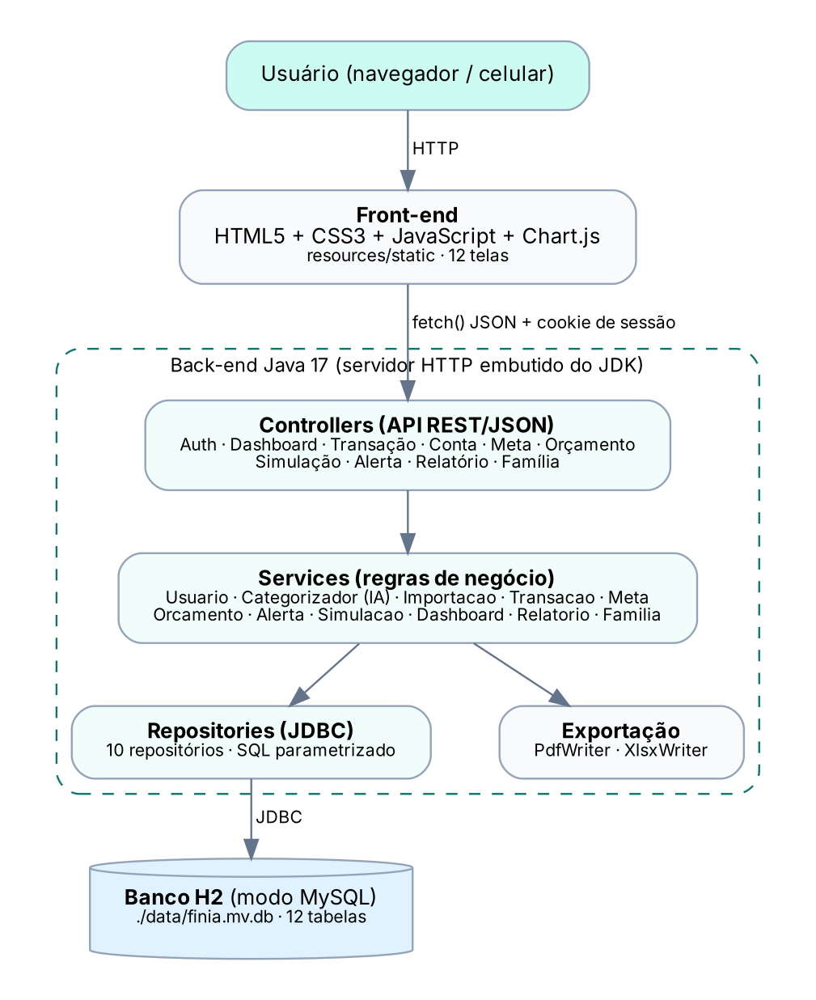

# FinIA – Gestão financeira pessoal e familiar com categorização automática

Projeto acadêmico (UCSAL, 2026) desenvolvido a partir da documentação de requisitos do FinIA
(RF01–RF12, RNF01–RNF08). Back-end em **Java 17**, front-end em HTML/CSS/JavaScript e banco **H2**
integrado (modo compatível com MySQL).

## Funcionalidades

| Tela | Requisito | Back-end |
|---|---|---|
| Login, cadastro e confirmação de e-mail | RF01 | ✅ |
| Visão geral (dashboard) | RF07 | ✅ |
| Transações: importação CSV/OFX, categorização automática, reclassificação e regras | RF02, RF03, RF04 | ✅ |
| Contas e cartões (+ consentimento Open Finance simulado) | RF10, RF02 | ✅ |
| Metas com simulação de aporte | RF05 | ✅ |
| Orçamentos por categoria | RF09 | ✅ |
| Simulação "E se" | RF06 | ✅ |
| Alertas e preferências | RF08 | ✅ |
| Relatórios com exportação PDF e XLSX | RF11 | ✅ |
| Grupo familiar com permissões | RF12 | ✅ |

## Como executar

Pré-requisitos: **JDK 17+** e **Maven 3.8+**.

```bash
mvn package            # compila, roda os testes e gera target/finia.jar
java -jar target/finia.jar
```

Acesse **http://localhost:8080** e entre com a conta de demonstração:

- e-mail: `demo@finia.com`
- senha: `Demo@1234`

Na primeira execução o banco `./data/finia.mv.db` é criado e populado com seis meses de dados fictícios.
Para recomeçar do zero, apague a pasta `data/`.

Para usar MySQL em vez de H2, defina `FINIA_DB_URL`, `FINIA_DB_USER` e `FINIA_DB_PASS`
(o script `src/main/resources/schema.sql` é compatível).

## Arquitetura

```
front-end (resources/static)  ->  controllers (API REST/JSON)  ->  services (regras)  ->  repositories (JDBC)  ->  H2
```

- `controller/` – rotas da API, uma classe por tela
- `service/` – regras de negócio (categorizador, importação, metas, orçamentos, alertas, relatórios…)
- `repository/` – acesso a dados com SQL parametrizado
- `model/` – entidades do domínio (records Java)
- `infra/` – servidor HTTP, roteador, sessões, JSON, conexão com o banco e dados iniciais
- `export/` – geradores de PDF e XLSX sem bibliotecas externas



## Banco de dados

12 tabelas — ver `src/main/resources/schema.sql` e o diagrama em `docs/der.png`.

## Testes

`mvn test` executa 15 testes (unitários e de integração com H2 em memória) que verificam os
critérios de aceitação de RF01, RF02, RF03, RF04, RF05, RF09, RF10 e RF12.

## Documentação

- `docs/historias-de-usuario.md` – histórias de usuário e critérios de aceitação
- `docs/roteiro-entrevistas.md` – roteiro das entrevistas com usuários
- `docs/api.md` – endpoints da API
- Quadro do processo no Trello: https://trello.com/b/NL43b6Hb/finia-processo-de-desenvolvimento

## Limitações conhecidas

- A conexão Open Finance é simulada (registro do consentimento); a integração real exige credenciamento.
- O envio de e-mail e de notificações push é simulado dentro do sistema.
- O "modelo de IA" é um classificador por palavras-chave ponderadas + aprendizado com as correções do usuário.
